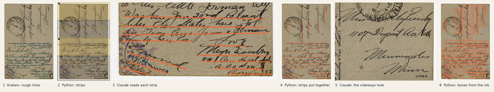

# Bounding Box Bonanza: can Claude do the volunteers' job?

On **903 handwritten manuscript pages** from the Zooniverse project
[Bounding Box Bonanza](https://www.zooniverse.org/projects/blicksam/bounding-box-bonanza), Claude, used out of the box
with no training and no example pages, is given the volunteers' job: **find every line of handwriting, read its words
and put a box around it**. An expert who transcribed every page line by line is the answer key; the volunteers' own
boxes are the comparison.

<a href="https://vedpiyush93-stack.github.io/BBB/"><b>Website</b></a> ·
<a href="https://vedpiyush93-stack.github.io/BBB/viewer/"><b>Browse all 903 pages</b></a> ·
<a href="https://vedpiyush93-stack.github.io/BBB/slides/"><b>See the slides</b></a>

## The method in brief

1. **Kraken finds the lines.** A free line finder that can't read marks every line of writing and draws an outline
   around it.
2. **Claude reads the page, in one call.** It sees the page with Kraken's lines numbered in red and writes out every
   line's words, saying which red line(s) each sits on.
3. **Boxes.** Each box is the smallest rectangle around Kraken's outline of a line; boxes that overlap meet halfway.
4. **Claude checks the boxes, in a second call.** It sees the boxes drawn and numbered and corrects only the ones that
   are clearly wrong (for example a box that cuts off the last words of a line).

Kraken alone scores 83.9 (line score: found and match in one number out of 100) and can't read. Claude's one answer per page drops Kraken's junk lines, joins
its broken pieces, splits lines that run across two pieces of writing, adds the lines Kraken missed and reads every
word: the score rises to 94.8 (both paired by the same AI without Claude's words, since Kraken's lines have none).

## Results on 791 held-out pages

To score, an AI (Claude Opus 5.5, used only to evaluate) pairs Claude's lines with the expert's by their positions and
words; a pair counts as found. No person has checked its pairs.

| | |
|---|---|
| Found | 92.9%: 17,886 of the expert's 19,263 lines |
| Match | 97.0%: 17,886 of Claude's 18,430 lines |
| Line score | 94.9 (found and match in one number out of 100, high only when both are high; 95% range: 94.1 to 95.7, re-picking the pages at random 2,000 times) |
| Words and letters (on the pairs) | 94% of the expert's words, 3.7 letter errors per 100 |
| Boxes | 88% of the expert's lines sit inside one box; 89% of boxes hold exactly one line |

Against the volunteers, on the 271 held-out pages they boxed (each box read as the line along its bottom edge; every
set, Claude's included, paired by the same AI without the set's words): Claude 95.8 · best volunteer on each page 95.6 ·
median volunteer 92.9 · volunteers' consensus 83.8. The best volunteer is picked afterwards on each page; Claude is
level with it counting every line (+0.2, range −0.9 to +1.4) and ahead of the median volunteer (+3.0). Not counting the printed lines left unpaired (volunteers mostly skip printed text): Claude 96.8 · best 98.2 · median 96.3: Claude is
at least as good as the median volunteer, a little below the best one. These pages are easier than the
rest (Claude 94.3 on the other 520). The answer key is one transcriber's work.

## Work in progress

This repository holds the website only. The code, the notebook with every step and prompt, and the scripts to
reproduce the results will be released after review with the project team. No licence is granted yet: please ask
before reusing anything here.

The pages, the expert's transcriptions and the volunteers' boxes come from the Zooniverse projects Bounding Box Bonanza
and ACLS HTR Gold Standard Data and belong to their owners and to the archives that hold the originals. The page images
in the browser load directly from Zooniverse. Volunteers are never named.
